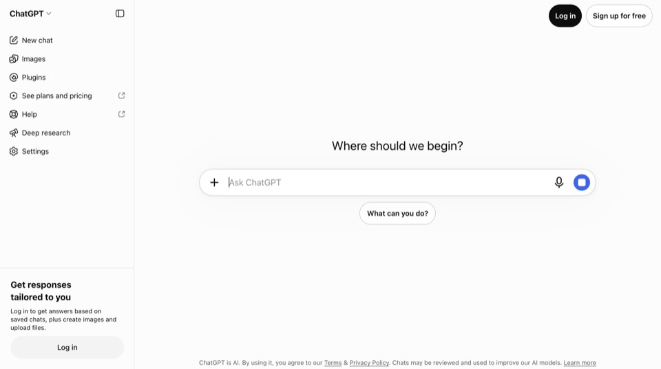
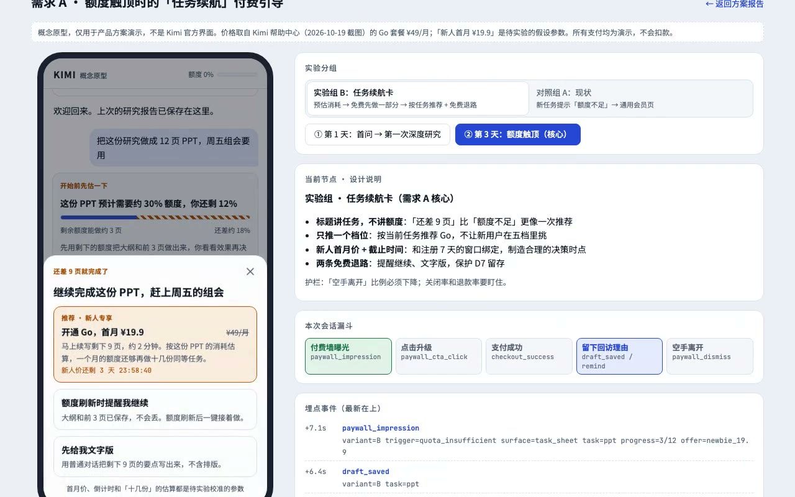

# Kimi 新用户 7 日会员转化方案

> 视角：AI 产品经理 ｜ 日期：2026 年 11 月 ｜ 交付物：本文档 + 可交互原型（需求 A）+ 原型录屏 + 代码仓库

---

## 0. 一页摘要

**要解决的问题**：提升注册 7 天内新用户的会员转化率，同时 D7 留存不能下降。

**核心判断**：付费引导应该出现在用户「正在做一件重要的事、额度不够了」的那一刻，而不是打开产品的那一刻。现在 Kimi 在这一刻的处理是「新任务提示额度不足」，用户手里什么都没有，转化和留存同时受损。把这一刻改成「先帮你做一部分，再告诉你还差多少、怎么补上」，并给不付费的人留一条免费退路，转化可以上升，留存也有保护。

**三个需求（按优先级）**

| 优先级 | 需求 | 作用的旅程节点 | 主要影响的指标 |
|---|---|---|---|
| P0 | A. 额度触顶时的「任务续航」付费引导 | 撞墙 → 收银台 | 付费墙点击率、支付率 → 7 日转化率 |
| P1 | B. 首问后的「能力发现」卡 | 首问 → 激活 | Agent 能力渗透率 → 触顶率 → 7 日转化率 |
| P2 | C. 会员页按使用情况推荐档位 | 收银台 | 收银台下单率 |

**为什么 A 排第一**：它离转化最近，只影响已经撞墙的用户，留存风险最低，7 天内就能读出实验结果。

**原型**：需求 A 的可交互原型，支持实验组 / 对照组切换，并实时显示埋点事件和会话漏斗。附录 A 列出访问方式。

---

## 1. 问题拆解

### 1.1 目标与约束

- **首要目标**：7 日会员转化率。
- **硬约束**：D7 留存不下降。
- **两者的矛盾**：付费引导越重，越可能打扰用户、拉低留存。所以方案要回答的不是「推不推付费」，而是「在哪个时刻推、推的时候给用户留什么」。

### 1.2 转化率可以拆成一条漏斗

7 日会员转化率 ≈ 激活率 × Agent 能力渗透率 × 额度触顶率 × 付费墙点击率 × 支付成功率

（另有不经过触顶、直接付费的路径，单独统计。）

拆开之后，每个需求都能对应到具体的一段：需求 B 提升前两项，需求 A 提升后两项，需求 C 提升最后一项。这也是后面排序的依据：先找离钱最近、确定性最高的一段。

---

## 2. 用户旅程分析

### 2.1 走查方法

| 走查 | 方式 | 覆盖范围 |
|---|---|---|
| 游客走查 | 全新、无登录信息的浏览器，中文环境，桌面 1280px 和手机 390px | 首页 → 首问 → 登录弹窗 → 能力入口 → 灵感库 |
| 会员账号走查 | 已有会员账号 | 登录后的首页、额度提示、侧边栏 |
| 官方资料 | Kimi 帮助中心会员说明（价格截图日期 2026-10-19） | 会员档位、价格、额度规则、额度用完后的处理 |
| 竞品走查 | 无登录浏览器 | ChatGPT 游客首页；豆包（香港网络） |

**未覆盖**：新注册账号登录后的新手引导、免费额度大小、第一次额度用完的真实界面。这几处在文中标为「待核实」。

### 2.2 旅程地图

| 节点 | 时间 | 用户在做什么 | 卡点 | 风险 |
|---|---|---|---|---|
| ① 落地 | D0 | 从搜索、投放、口碑进入首页 | 首页只有输入框和 7 个能力按钮，没讲清和其他产品的区别 | 中 |
| ② 登录 | D0 | 发出第一个问题 | **游客发出第一个问题就弹登录，拿不到任何回答**；弹窗没说登录后能得到什么 | 中高 |
| ③ 首问 | D0 | 问一个普通问题 | 回答和普通聊天机器人差别不大，问完就走 | **高（最大流失点）** |
| ④ 激活 | D0–D1 | 第一次用深度研究、PPT 等 Agent 能力 | 能力入口平铺，和用户的问题无关；精彩案例要点进去才看得到 | 高 |
| ⑤ 回访 | D1–D3 | 隔天回来做第二件事 | 没有未完成的任务，也没有提醒 | 中 |
| ⑥ 撞墙 | D2–D6 | 发起重要任务，额度不够 | 新任务直接提示额度不足；任务没开始；没有免费退路 | **高（最大转化杠杆）** |
| ⑦ 收银台 | D2–D7 | 看会员页、选档、支付 | 五档会员按功能列权益，换算不成「我的事能不能做完」 | 中 |
| ⑧ 首月 | D7–D30 | 使用会员、决定是否续费 | 付费后没被引导去用会员能力 | 中 |

风险高低是基于走查的判断，需要用埋点数据确认。

### 2.3 关键发现

**发现 1：最大流失点在「首问 → 激活」，而且之前还有一道登录门槛。**

- 证据：游客发出第一个问题就弹出登录弹窗（微信扫码 / 手机验证码），一个回答都拿不到；弹窗里没有「登录后能得到什么」。对照 ChatGPT，游客可以直接提问，左侧登录提示写的是「登录后可以基于历史对话回答、生成图片、上传文件」。
- 证据：深度研究的「精彩案例」只有点了深度研究按钮才出现；3D、游戏、网页模板这些最容易让人觉得「原来它能做这个」的内容，入口是首页底部一行灰色小字「探索灵感」。
- 含义：大多数新用户从没碰到 Kimi 真正领先的 Agent 能力，后面也就不会撞墙、不会进入付费漏斗。

**发现 2：最大的转化杠杆在「撞墙」，但现在这一刻被处理成了报错。**

- 证据：帮助中心写明，额度用完时「当前正在进行的任务可以正常完成，新任务将提示额度不足」。出路是等待刷新、升级会员、购买加油包（仅会员可开启）或参加活动。
- 证据：额度是一个所有会员功能共享的池子，按 token 扣除，只显示百分比；查看路径是「头像 → 设置 → 订阅」，日常对话界面看不到。发送按钮的悬停提示只写「Sending a message uses credits」，没说扣多少。
- 含义：用户带着一个有截止时间的任务来，这是 7 天里付费意愿最高的时刻。但此时用户不知道这个任务要多少额度、还差多少，手里没有任何成果，看到的是一张通用的五档会员表，不付费也没有退路。转化没拿到，用户对产品的最后印象还是「被拦住」。

### 2.4 会员体系现状（官方资料）

| 套餐 | 连续包月 | 年付折合每月 | 主要差异 |
|---|---|---|---|
| Go | ¥49 | ¥39 | 文档、PPT、深度研究、网站部署；不含 Kimi Code |
| Plus | ¥99 | ¥79 | 2 倍 Agent 额度，含 Kimi Code、Agent 集群 |
| Pro | ¥199 | ¥159 | 4 倍 Agent 额度，含目标模式、专属 Kimi Claw |
| Max | ¥699 | ¥559 | 14 倍 Agent 额度，4 个任务并行 |
| Ultra | ¥1,399 | ¥1,119 | 28 倍 Agent 额度 |

来源：Kimi 帮助中心，价格截图日期 2026-10-19。上线前以会员购买页为准。

对新用户来说，入门门槛是 Go ¥49/月；但「2 倍 Agent 额度」「Agent 集群」这类表述，需要先理解产品才能换算成价值。

---

## 3. 指标体系

### 3.1 核心指标

**7 日会员转化率**：注册后 7×24 小时内首次支付成功的用户数 ÷ 同期注册用户数。按注册日 cohort 计算，剔除 7 天内退款和测试账号。

### 3.2 过程指标

| 漏斗层 | 指标 | 定义 |
|---|---|---|
| 激活 | D0 激活率 | 注册当天完成 ≥2 轮对话，且用过 ≥1 个 Agent 能力 |
| 激活 | Aha 达成率 | 7 天内完成一次 Agent 任务，并查看或下载了产出 |
| 关键功能 | Agent 能力渗透率 | 7 天内用过任一 Agent 能力的新用户占比，按能力拆分 |
| 付费页 | 额度触顶率 | 7 天内至少一次因额度不足而无法完成任务的新用户占比 |
| 付费页 | 付费墙曝光率 / 点击率 | 曝光 UV ÷ 新用户；点击升级 UV ÷ 曝光 UV；按曝光场景拆分 |
| 收银台 | 下单率 / 支付成功率 | 进入收银台 → 发起支付 → 支付成功 |

### 3.3 护栏指标

| 护栏 | 规则 |
|---|---|
| **D7 留存（主护栏）** | 实验组相对对照组的降幅不超过 0.5pp（非劣效检验，单侧 95%） |
| D1 留存 | 同上，用来更早发现问题；降幅超过 1pp 立即暂停实验 |
| 触顶后空手离开率 | 付费墙曝光后 24 小时内，既没付费、也没保存或继续任何任务、也没回访的比例 |
| 付费弹层关闭率 | 关闭 ÷ 曝光，监控打扰程度 |
| 首月退款率、投诉率、次月续费率 | 防止新人价拉来低质量付费 |

---

## 4. 需求提炼

### 4.1 判断标准

用四个维度判断一个需求值不值得先做：

1. **离钱的距离**：作用在漏斗的哪一段，越靠近支付越确定。
2. **作用人群**：影响多少新用户。
3. **留存风险**：会不会打扰没准备付费的人。
4. **验证速度与成本**：多久能读出结果，研发量多大。

### 4.2 需求 A（P0）：额度触顶时的「任务续航」付费引导

| 项目 | 内容 |
|---|---|
| 旅程节点 | ⑥ 撞墙 → ⑦ 收银台 |
| 要解决的问题 | 用户发起重要任务时额度不足：不知道要多少、还差多少；手里没有任何成果；只看到通用会员页；不付费就没有出路 |
| 方案 | ① 发任务时先预估消耗：「这份 PPT 约需 30%，你还剩 12%」，并换算成「能做几页」 ② 用剩余额度先免费做出大纲和前几页，自动保存 ③ 标题讲任务而不是讲额度（「还差 9 页就完成了」），只推荐一个档位（Go），附新人首月价，有效期和注册 7 天窗口绑定 ④ 两条免费退路：额度刷新时提醒继续；用普通对话先给文字版 ⑤ 付费后直接接着做，不用重新发起 |
| 预期影响 | 付费墙点击率、支付率上升 → 7 日转化率上升；触顶后空手离开率下降 → D7 留存持平或上升 |
| 验证方式 | 注册时按用户 ID 随机 50/50 分组，跑满 2 个完整的 7 日 cohort。主分析看全体新用户，辅助分析看触顶用户。D7 留存做非劣效检验。新人首月价单独作为一个因子（¥19.9 / ¥29.9 / 无折扣），避免把「设计」和「降价」的效果混在一起 |

### 4.3 需求 B（P1）：首问后的「能力发现」卡

| 项目 | 内容 |
|---|---|
| 旅程节点 | ② 登录 → ③ 首问 → ④ 激活 |
| 要解决的问题 | 用户问完一个问题就走，没见过 Kimi 的 Agent 能力；能力入口和用户的问题无关 |
| 方案 | ① 首轮回答后，按问题意图只推荐一个能一键执行的 Agent 能力（问公司 → 深度研究；问写作 → PPT），写清耗时和产出，并附对应的精彩案例 ② 新用户前 3 天的第一次 Agent 任务额外赠送一次额度，保证第一次体验不撞墙 ③ 小实验：登录弹窗加一句「登录后可免费体验深度研究和 PPT」 |
| 预期影响 | D0 激活率、Agent 能力渗透率、Aha 达成率上升 → 触顶率上升 → 7 日转化率上升；D1、D7 留存上升 |
| 验证方式 | A/B 实验。先看推荐卡点击率和 Aha 达成率（一周内可读），再看 7 日转化和 D7。意图识别准确率单独抽样人工评估 |

### 4.4 需求 C（P2）：会员页按使用情况推荐档位

| 项目 | 内容 |
|---|---|
| 旅程节点 | ⑦ 收银台 |
| 要解决的问题 | 五档会员按功能列权益，新用户算不清该买哪档，在选档时犹豫流失 |
| 方案 | ① 根据 7 天内的使用情况默认选中一个档位（「你这周做了 3 次深度研究、1 份 PPT，Go 够用」） ② 权益从功能清单改写成「每月大约能做多少件事」 ③ 默认只展开 Go 和 Plus |
| 预期影响 | 收银台下单率、支付成功率上升；ARPPU 可能下降，需要同时监控 |
| 验证方式 | A/B 实验。主指标是收银台转化率，同时看 ARPPU 和首月后升档率 |

### 4.5 优先级排序

| 需求 | 离钱的距离 | 作用人群 | 留存风险 | 研发成本 | 读出结果 |
|---|---|---|---|---|---|
| **A 任务续航** | 最近 | 触顶用户 | 低 | 中 | 快（7 日 cohort） |
| B 能力发现 | 远（上游） | 全部新用户 | 低，可能正向 | 高 | 慢 |
| C 档位推荐 | 近 | 最少 | 极低 | 低 | 快 |

**结论**：

- **A 排第一**：离转化最近、留存风险最低、最快读出结果。
- **B 排第二**：潜在上限可能更大，但链路长、依赖意图识别质量。而且 B 带来的更多触顶，需要 A 先把「撞墙之后」接住，才能变成付费。
- **C 排第三**：改动小，可以和 A 并行，但作用人群最少。

---

## 5. 需求 A 的实验设计

| 项目 | 设计 |
|---|---|
| 假设 | 触顶时先交付部分成果、按任务推荐单一档位并提供免费退路，能让 7 日转化率相对提升 ≥15%，且 D7 留存降幅不超过 0.5pp |
| 分组 | 注册时按用户 ID 哈希分组，跨端一致；同一用户 7 天内始终在同一组 |
| 口径 | 主口径为全体新用户（意向处理）；触顶用户为辅助分析 |
| 样本量（示意） | 假设 7 日转化基线 2.0%（假设值），检测相对 +15%（到 2.3%），α=0.05、功效 80%：每组约 3.7 万名新用户 |
| 停止条件 | D1 留存降幅超过 1pp；首月退款率或投诉率翻倍；消耗预估误差超过 30% 的比例过高 |

---

## 6. 原型说明

### 6.1 原型做了什么

原型选择需求 A，用一个手机界面模拟新用户第 1 天和第 3 天的完整故事：

1. **第 1 天**：问一个普通问题 → 出现能力发现卡（需求 B 的简化版）→ 第一次生成深度研究报告。
2. **第 3 天**：带着「把研究做成 12 页 PPT，周五组会要用」的任务回来，额度只剩 12%。
3. **实验组**：预估消耗 → 免费生成大纲和前 3 页 → 任务续航卡（推荐 Go 新人首月价 / 提醒我继续 / 先给文字版）→ 付费后自动续写剩余 9 页。
4. **对照组**：模拟现状，新任务提示「额度不足」→ 通用会员页 → 关闭后空手离开。

右侧控制台可以切换实验组和对照组，并实时显示埋点事件（如 `paywall_impression`、`paywall_cta_click`、`checkout_success`、`paywall_fallback`）和本次会话漏斗。

### 6.2 原型和方案的对应关系

| 方案要点 | 原型里的位置 |
|---|---|
| 动手前预估消耗 | 「这份 PPT 预计需要约 30% 额度，你还剩 12%」卡片 |
| 先免费交付一部分 | 大纲 + 前 3 页缩略图，自动保存 |
| 标题讲任务、只推一个档位 | 续航卡标题「还差 9 页就完成了」，只推荐 Go |
| 新人首月价与截止时间 | 「首月 ¥19.9」与倒计时（实验参数，非真实价格） |
| 免费退路 | 「额度刷新时提醒我继续」「先给我文字版」 |
| 付费后无缝续写 | 支付成功后进度条从 4/12 继续到 12/12 |
| 护栏可观测 | 漏斗里的「留下回访理由」和「空手离开」 |

---

## 7. 风险与反方观点

| 判断 | 最强的反驳 | 应对 |
|---|---|---|
| 触顶时推付费最有效 | 如果免费额度足够大，大部分新用户 7 天内撞不到墙，A 作用的人群太小 | 先查 7 日触顶率。如果低于 10%（假设阈值），就把 B 提到 P0，或调整新用户额度，让 Aha 和撞墙都发生在 7 天内 |
| 预估消耗能减少挫败感 | 把成本摆在眼前，可能让用户不敢用 Agent 能力 | 只在剩余额度不够这个任务时才显示预估；把 Agent 能力渗透率加进监控 |
| 新人首月价能拉高转化 | 折扣拉来低意愿用户，次月续费差 | 价格单独做实验因子，以「首月 + 次月」累计收入做决定 |
| 免费退路能保护留存 | 部分本来会付费的人选择等待，转化被稀释 | 留存是底线，这是有意的取舍；同时追踪「提醒 → 回访 → 再次触顶 → 付费」的延迟转化 |

---

## 8. 局限与下一步

**已确认**：会员档位、价格、额度规则（官方资料）；游客从首页到首问的流程、登录弹窗、能力入口、灵感库、手机网页（实地走查）；ChatGPT 游客首页（竞品走查）。

**仍待核实**：

- 新注册账号登录后的新手引导、免费额度大小与刷新周期、第一次撞墙的真实界面
- App 端流程
- Perplexity、DeepSeek，以及内地网络下的豆包
- 所有基线数字（转化率、留存、触顶率）

**最容易出错的地方**：需求 A 的两个参数，即「免费额度在第几天让新用户撞墙」和「新人价给多少」，直接决定转化提升和留存损失之间的取舍，只能靠实验测出来。另外，消耗预估如果不准（说还差 18%，实际差 40%），会直接损害用户信任。

**上线前必须核验的数字**：

1. 新用户 7 日会员转化率基线
2. 新用户 D1、D7 留存基线
3. 7 日内额度触顶率，以及触顶用户的付费率
4. 免费档 Agent 额度和刷新规则
5. 各类 Agent 任务的平均额度消耗和预估误差分布
6. Go 套餐价格（以购买页为准）

---

## 附录 A：原型访问方式

| 形式 | 位置 |
|---|---|
| 可交互原型 | https://bill306.github.io/kimi-newuser-growth/site/prototype.html |
| 网页版报告 | https://bill306.github.io/kimi-newuser-growth/ |
| 代码仓库 | https://github.com/Bill306/kimi-newuser-growth （原型为 `site/prototype.html` 单文件，无需构建） |
| 录屏 | 仓库内 `原型录屏.mp4`（58 秒） |

## 附录 B：走查截图

| 编号 | 内容 | 文件 |
|---|---|---|
| 1 | 游客首页 | `site/shots/01_home_guest.jpg` |
| 2 | 游客首问即弹登录 | `site/shots/03_first_question_18s.jpg` |
| 3 | 深度研究入口与精彩案例 | `site/shots/05_deep_research_mode.jpg` |
| 4 | 灵感库 | `site/shots/09_inspiration.jpg` |
| 5 | 手机网页首页 | `site/shots/10_mobile_home.jpg` |
| 6 | 竞品：ChatGPT 游客首页 | `site/shots/c_chatgpt_home.jpg` |

## 附录 C：来源

- Kimi 帮助中心「会员是怎么收费的 / 套餐包括什么」：https://www.kimi.com/zh-cn/help/membership/membership-pricing
- Kimi 帮助中心「会员订阅服务权益介绍」：https://www.kimi.com/zh-cn/help/membership/membership-overview
- kimi.com、chatgpt.com、doubao.com 实地走查，2026-11-16 至 2026-11-17

本文是独立撰写的产品方案作业，不代表 Moonshot AI 官方观点。原型界面为概念演示，不是 Kimi 官方界面。
